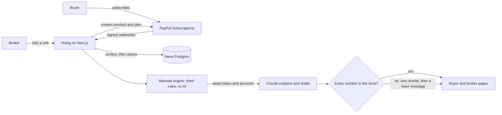

# Hulog

Hulog runs property installments in the Philippines on PayPal. When a payment slips, the buyer sees their exact grace period and refund rights under the Maceda Law (RA 6552), in English or Filipino, and their broker can follow up with a message ready to review and send.

*Hulog* is the Filipino word for an installment.

> Information only, not legal advice. Consult a lawyer or licensed broker.

## Try it

**Live demo: https://hulog.onrender.com**

No login or API keys needed. It runs on Render's free tier, so the first load can take a minute or more while it wakes up. All money is PayPal sandbox money.

A 3-minute tour:

1. **See who needs help.** Open the [broker page](https://hulog.onrender.com/broker). *Needs attention* lists the buyers who are behind, most urgent first.
2. **Draft a follow-up.** Press **Draft follow-up** on any of them, or **In Filipino**. Edit the message and copy it. Hulog never sends anything itself.
3. **Read a buyer's rights.** Tap a buyer to open their page, and switch between English and Filipino at the top.
4. **Ask a question.** Use **Ask Hulog** on that page, for example "What happens if I stop paying?". It answers from that buyer's live PayPal records.
5. **Miss a payment yourself.** On [this plan](https://hulog.onrender.com/buyer/I-U7BW563L9E5R), press **Simulate a missed payment**, then look at the broker page. **Resume plan** restarts the charges, and **Reset demo** puts it back.

### Example buyers

Each one is a real PayPal sandbox subscription at a different stage of a contract. They're locked so visitors can't change them. Plans bill daily in the demo, with each day standing in for a month, so the on-time counts keep moving.

| Buyer | Stage | What it shows |
|---|---|---|
| [Heaven](https://hulog.onrender.com/buyer/I-44AB396PNF68) | Missed, grace period over | What the page says once time has run out |
| [Krys](https://hulog.onrender.com/buyer/I-B6H6USY48STE) | Missed, in grace, under 2 years paid | 60 days of grace, no refund |
| [Dark](https://hulog.onrender.com/buyer/I-Y8XJ2NR46X4C) | Missed, in grace, over 3 years paid | 3 months of grace and a 50% refund |
| [Jesmer](https://hulog.onrender.com/buyer/I-242X6XTG64BB) | On time, early in the contract | What would apply if they missed a payment |
| [Benedict](https://hulog.onrender.com/buyer/I-0SAJ0NDCENJA) | On time, over 7 years paid, in USD | A 60% refund |
| [Macapal](https://hulog.onrender.com/buyer/I-9E5GA6EFYD6B) | Near the end of the contract | The last installments of a plan |

### Subscribe as a new buyer

On the broker page, press **Payment link** on a unit, or create one with **New unit**, then subscribe with a PayPal sandbox buyer account. You land on your own buyer page, with the demo buttons unlocked.

## The problem

About [2.16 million Overseas Filipino Workers](https://psa.gov.ph/content/2023-overseas-filipino-workers-final-results) worked abroad in 2023, and many are paying for a home back in the Philippines in monthly installments. When a salary is late or a job ends, the law already protects them. But [many buyers misunderstand the Maceda Law](https://gulfnews.com/business/property/ofw-paid-608000-for-a-manila-condo-what-the-maceda-law-can-and-cannot-save-1.500635734), so they may give up on what they've paid or keep paying out of fear of losing it.

Hulog is for two people:

- **The buyer** paying from abroad, who needs to know where they stand the moment a payment fails.
- **The licensed broker** managing several buyers, who needs to spot who's behind in time to help.

It doesn't cover bank or Pag-IBIG loans, or the sales RA 6552 excludes, such as industrial lots and commercial buildings.

## How it works



**Stack:** Next.js 15 (App Router), TypeScript, Tailwind CSS 4, Neon Postgres, hosted on Render.

## How PayPal is used

| PayPal feature | What Hulog does with it |
|---|---|
| Catalog Products API | Creates a product for each unit a broker lists |
| Billing Plans API | Creates the installment schedule: amount, frequency and number of payments |
| JS SDK Subscribe button | The buyer approves the plan on the payment page |
| Subscriptions API | Reads live status and billing details; suspends and resumes plans |
| Subscription transactions | Ask Hulog reads the buyer's charges straight from PayPal |
| Webhooks, with signature verification | Records each payment, failure and status change once, even if PayPal retries |
| Sandbox | All money and test accounts |

## How AI is used

The rule throughout is **the AI explains, code calculates**. Hulog uses Claude Haiku 5.5 in three places:

- **Rights explanation:** a short, plain-language paragraph on the buyer's page.
- **Ask Hulog:** a chat that answers from three read-only tools: the buyer's plan, their PayPal charges, and their rights. The tools are tied to that buyer on the server, and none of them can change anything.
- **Broker follow-ups:** a draft message for the broker to review. A person always sends it.

Every AI answer passes a check before anyone sees it. Each number must appear in the facts code provided, and spelled-out numbers, links and markdown are rejected. A rejected chat answer or follow-up draft gets one rewrite, then a fixed message. A rejected rights paragraph goes straight to fixed text. The check catches wrong numbers, not every wrong statement, so the exact figures also appear separately on the page, and brokers review each follow-up.

**Assisted with:** Claude Code, used for planning, implementation, testing and review.

## The Maceda Law engine

[lib/maceda.ts](lib/maceda.ts) calculates every legal number with fixed rules. It's covered by test cases reviewed by a licensed real estate broker ([docs/maceda-test-cases.md](docs/maceda-test-cases.md)).

| Installments paid | Grace period | If the contract is cancelled |
|---|---|---|
| Under 2 years (Sec. 4) | At least 60 days from the due date | No refund. The seller can cancel only 30 days after the buyer receives a notarial notice |
| 2 years or more (Sec. 3) | 1 month per year paid, interest-free, usable once every 5 years of the contract | A refund of 50% of what was paid, plus 5% per year after year 5, up to 90%. Cancellation takes effect 30 days after the notarial notice and after the refund is paid |

Buyers who move to Hulog partway through a contract keep their history: the broker enters the installments already paid, and PayPal bills the rest.

## What's real and what's simulated

| Real | Simulated or on trust |
|---|---|
| PayPal sandbox plans, subscriptions and charges | **Failed payments.** The sandbox can't fail a payment on cue, so these are marked rows in Hulog's own ledger, labelled "(simulated)", and they don't appear in PayPal |
| Webhooks, including signature checks | **Installments paid before Hulog.** PayPal doesn't know about them, so this count is the broker's word, and the page says so |
| Suspending and resuming plans on PayPal | **Timing.** Plans charge daily in the demo instead of monthly |
| Rights calculations and AI answers | **The 75-day miss.** Heaven's page shows a real charge next to a backdated simulated miss, the only way to show an expired grace period |

Some limits are deliberate for a hackathon demo:

- There's no login, so the board and buyer pages are public. Real customers would need accounts first.
- Hulog doesn't send reminders or notarial notices. The broker sends each follow-up.
- There's one broker, and it runs on the PayPal sandbox only.
- On the demo board, each name shows only its newest plan.

## Run locally

You'll need Node 20.6 or newer, a [PayPal sandbox app](https://developer.paypal.com/dashboard/applications), and a Postgres database such as [Neon](https://neon.tech).

```powershell
npm install
Copy-Item .env.example .env.local
```

Fill in `.env.local`:

| Variable | Needed for |
|---|---|
| `PAYPAL_CLIENT_ID`, `PAYPAL_CLIENT_SECRET` | Everything that talks to PayPal |
| `PAYPAL_WEBHOOK_ID` | Verifying webhooks |
| `DATABASE_URL` | The payment ledger |
| `DEMO_MODE=true` | Daily billing and the demo buttons |
| `ANTHROPIC_API_KEY` | Optional. Without it, buyers see fixed text and the chat says it's switched off |

Create the tables, then start the app:

```powershell
node --env-file=.env.local scripts/migrate.mjs
npm run dev
```

Open http://localhost:3000.

**Webhooks** need a public URL, so point a webhook in your PayPal app at `https://<your-host>/api/webhooks/paypal`. Subscribe it to `BILLING.SUBSCRIPTION.*` and `PAYMENT.SALE.*`.

**Your own data:** the locked example buyers in [lib/demo.ts](lib/demo.ts) only exist in the hosted demo's sandbox account, so your board starts empty.

## Tests

```powershell
npm test
```

The tests cover the Maceda engine, the AI number check, Ask Hulog's tool loop, follow-up drafts, webhook handling, the PayPal client and the rate limits.

## License

[MIT](LICENSE)
